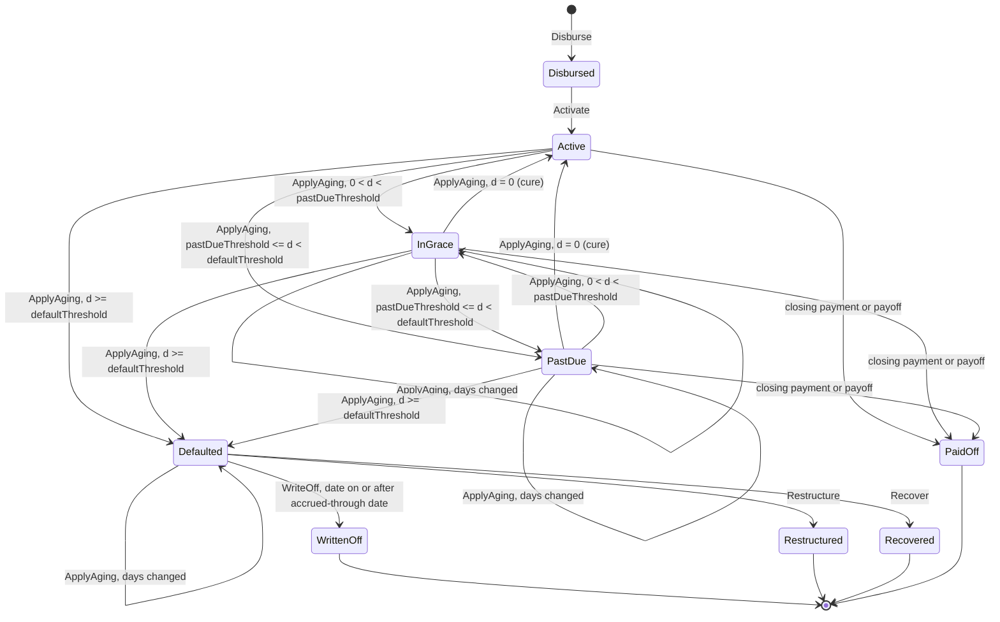

# Loan lifecycle

**Status:** Implemented (M2-04). The transition contract comes from owner decisions D3 and D5. [ADR-0011](../adr/0011-m2-module-contracts.md)

The Servicing module's `Loan` aggregate emits a domain event for each state transition. The integration event column specifies the outbox publications planned for M2-08. Invalid transitions return a failed `Result<T, DomainError>`.

## States

A payment that leaves a balance, an accrual, and an aging run that changes nothing are not transitions and draw no arrow. [Payments and accrual](#payments-and-accrual) and [No-op or transition](#no-op-or-transition) say what each of them emits.

- `Disbursed` — initial state immediately after confirmed disbursement.
- `Active` — performing; no days past due.
- `InGrace` — 1 day ≤ days past due < `PastDueThreshold`. With the default threshold of 1 the range is empty, so a loan never enters `InGrace` until a product configures a longer grace period.
- `PastDue` — `PastDueThreshold` ≤ days past due < `DefaultThreshold`.
- `Defaulted` — days past due ≥ `DefaultThreshold` (default 90).
- `WrittenOff`, `Restructured`, `Recovered`, `PaidOff` — terminal.

## Transition table

The table and diagram specify the state transitions. The domain event column lists payment and lifecycle events. A posting from implicit accrual precedes those events when the accrual date advances.

`d` is the `DaysPastDue` the caller supplies. `pd` is `pastDueThreshold` and `def` is `defaultThreshold`.

| From | Command | Guard | To | Event emitted (domain) | Integration event |
|---|---|---|---|---|---|
| (none) | Disburse | the disbursement intent exists and has not produced a loan | Disbursed | `LoanDisbursed` | `LoanDisbursed` |
| Disbursed | Activate | `EffectiveDate` is the first business day after the disbursement date, under the product's calendar | Active | `LoanActivated` | `LoanActivated` |
| Active | ApplyAging | d = 0 | Active | — (no-op) | — |
| Active | ApplyAging | 0 < d < pd | InGrace | `LoanEnteredGracePeriod` | `LoanAged` |
| Active | ApplyAging | pd ≤ d < def | PastDue | `LoanBecamePastDue` | `LoanAged` |
| Active | ApplyAging | d ≥ def | Defaulted | `LoanDefaulted` | `LoanAged` |
| InGrace | ApplyAging | d = 0 (cure) | Active | `LoanBecameActive` | `LoanAged` |
| InGrace | ApplyAging | 0 < d < pd and d ≠ current `DaysPastDue` | InGrace | `LoanPastDueDaysUpdated` | `LoanAged` |
| InGrace | ApplyAging | 0 < d < pd and d = current `DaysPastDue` | InGrace | — (no-op) | — |
| InGrace | ApplyAging | pd ≤ d < def | PastDue | `LoanBecamePastDue` | `LoanAged` |
| InGrace | ApplyAging | d ≥ def | Defaulted | `LoanDefaulted` | `LoanAged` |
| PastDue | ApplyAging | d = 0 (cure) | Active | `LoanBecameActive` | `LoanAged` |
| PastDue | ApplyAging | 0 < d < pd (partial cure) | InGrace | `LoanEnteredGracePeriod` | `LoanAged` |
| PastDue | ApplyAging | pd ≤ d < def and d ≠ current `DaysPastDue` (re-aging) | PastDue | `LoanPastDueDaysUpdated` | `LoanAged` |
| PastDue | ApplyAging | pd ≤ d < def and d = current `DaysPastDue` | PastDue | — (no-op) | — |
| PastDue | ApplyAging | d ≥ def | Defaulted | `LoanDefaulted` | `LoanAged` |
| Defaulted | ApplyAging | d ≥ def and d ≠ current `DaysPastDue` (re-aging) | Defaulted | `LoanPastDueDaysUpdated` | `LoanAged` |
| Defaulted | ApplyAging | d ≥ def and d = current `DaysPastDue` | Defaulted | — (no-op) | — |
| Active / InGrace / PastDue | AccrueInterest | `BusinessDate` is after `AccruedThroughDate` | same | `InterestAccrued` (internal only) | — |
| Active / InGrace / PastDue | AccrueInterest | `BusinessDate` is on or before `AccruedThroughDate` | same | — (no-op) | — |
| Defaulted | AccrueInterest | as above | Defaulted | `InterestAccrued` (internal only) | — |
| Active / InGrace / PastDue | RecordPayment | amount > 0, currency matches, `EffectiveDate` ≥ `AccruedThroughDate`, balance remains after allocation | same | `PaymentReceived` (not a transition; excess is zero) | `PaymentRecorded` |
| Active / InGrace / PastDue | RecordPayment | as above, and allocation leaves all four balances at zero (excess may be positive) | PaidOff | `PaymentReceived`, `PaymentExcessRecorded` if excess > 0, `LoanPaidOff` | `PaymentRecorded`, `PaymentExcessRecorded` if excess > 0, `LoanPaidOff` |
| Active / InGrace / PastDue | ExecutePayoff | the quote total still equals the recomputed total for the same payoff date | PaidOff | `PaymentReceived`, `LoanPaidOff` | `PaymentRecorded`, `LoanPaidOff` |
| Defaulted | WriteOff | reason non-empty and `BusinessDate` ≥ `AccruedThroughDate` | WrittenOff | `LoanWrittenOff` | `LoanWrittenOff` |
| Defaulted | Restructure | plan non-empty | Restructured | `LoanRestructured` | `LoanRestructured` |
| Defaulted | Recover | method non-empty, amount ≥ 0 | Recovered | `LoanRecovered` | `LoanRecovered` |

Any other `(state, command)` pair returns `Result<Unit, DomainError>.Failure(new InvalidStateTransition(stateName, commandName, reason))`, using the state and command names as strings. See [ADR-0009](../adr/0009-result-and-domainerror-in-core.md). Two cases of that rule are listed because the transition table does not give them a row:

- `ApplyAging` on a `Defaulted` loan with d < `def`. A defaulted loan does not cure through aging.
- `RecordPayment`, `ExecutePayoff` or `AccrueInterest` on a loan in `Disbursed`, or in a terminal state (accrual is also refused on `Disbursed`).

## No-op or transition

`ApplyAging` compares the supplied days with the loan's current `(State, DaysPastDue)`:

- **Transition.** The state changes. One domain event, one history row, one `LoanAged` integration event.
- **Days update.** The state is the same and `DaysPastDue` changes. This is *not* a state transition, but it is a recorded change: one `LoanPastDueDaysUpdated` domain event, one history row, one `LoanAged` (its payload names the previous and new state, so a consumer can tell the two apart).
- **No-op.** The state and `DaysPastDue` are both unchanged. The aggregate returns `AgingResult { Changed = false }` and emits no event. The M2-08 handler stores a receipt so a retry returns the same result.

"Every transition emits exactly one domain event" (the Servicing invariant and the roadmap acceptance) holds because a no-op is not a transition. An active loan with zero days past due is the common no-op.

## Payments and accrual

These rules are the owner's decision D3 ([ADR-0011](../adr/0011-m2-module-contracts.md)).

- **Eligibility.** Ordinary payments are accepted in `Active`, `InGrace` and `PastDue`. Payments on a `Defaulted` loan are **not decided** (see [Not decided](#not-decided)); until then they return `InvalidStateTransition`.
- **Overpayment.** A positive overpayment on an eligible loan is allowed. The payment is allocated through `PaymentAllocationWaterfall` ([payment-allocation.md](payment-allocation.md)) after interest has been accrued to the payment's effective date. Whatever the waterfall cannot place is the `Excess`.
- **Excess implies payoff.** `Excess > 0` only happens when all four balances reach zero, so such a payment always moves the loan to `PaidOff`. The excess is recorded for return: it is in the `PaymentRecorded` payload and in its own `PaymentExcessRecorded` event, and the loan keeps no credit balance. The return of the money to the payer is a treasury process outside M2.
- **Backdating.** `EffectiveDate` earlier than `AccruedThroughDate` is a `ValidationError` on `effectiveDate`.
- **Accrual order.** `RecordPayment`, `ExecutePayoff`, and `WriteOff` accrue through their effective date before recording the outcome. If the date advances accrual, an internal `InterestAccrued` event comes first and supplies the ledger posting. Eligibility, inputs, and payoff quote revalidation must succeed before the events are appended. [Servicing accrual rules](../modules/servicing.md#interest-accrual-and-posting)
- **Write-off.** A date before `AccruedThroughDate` returns `ValidationError` on `businessDate`. The write-off reports the full outstanding balance after accrual, including principal, both interest balances, and fees. The terminal record retains those components for audit. [Owner decision on M2-04](https://github.com/ZeppBoy/Credere/issues/71#issuecomment-7216076988)
- **Fees.** M2 posts no fees, so `FeesOutstanding` is zero on every M2 loan. The field exists so that the waterfall is the full waterfall from the first slice.

## Thresholds

- `pastDueThreshold` — default 1 day. Configurable per product.
- `defaultThreshold` — default 90 days. Configurable per product; subject to IFRS 9 and local regulatory floors (see [`ifrs9-staging.md`](ifrs9-staging.md)).

Both thresholds are copied from the product configuration onto the loan at disbursement and are immutable after that.

## Days-past-due semantics

- `daysPastDue` is computed by the aging batch, not by the aggregate. The aggregate receives `daysPastDue: int` as a command parameter. Deriving it from the schedule and the unpaid balances is the batch's concern (M4).
- The aggregate tracks `DaysPastDue` as nullable (null when `State` is `Disbursed` or `Active`, non-null otherwise).
- "Business days" interpretation is governed by the product's business calendar ([servicing.md](../modules/servicing.md#business-dates-and-calendars)); the aging batch is responsible for that interpretation and passes the numeric result in.

## Not decided

These are open, and the contract above holds until the owner decides them. Each is also raised on the M2-C1 pull request.

1. Whether payments are accepted on a `Defaulted` loan, and what they do to its state.
2. Whether a `Defaulted` loan can ever cure back to `Active` (today it can only reach a terminal state).

## Rehydration

The aggregate supports rehydration from its persisted event stream. A rehydrated aggregate emits no events during replay. Any event in the stream that this version of the code does not understand is a hard error; schema evolution requires explicit upcasters (see [`../adr/0004-append-only-history.md`](../adr/0004-append-only-history.md)).

## Diagram sync

The diagram in this document and the transition table are the authoritative specification. The aggregate's `ApplyAging` / `Activate` / `AccrueInterest` / `RecordPayment` / `ExecutePayoff` / `WriteOff` / `Restructure` / `Recover` implementations must match this table exactly. A PR that changes either must update both.
