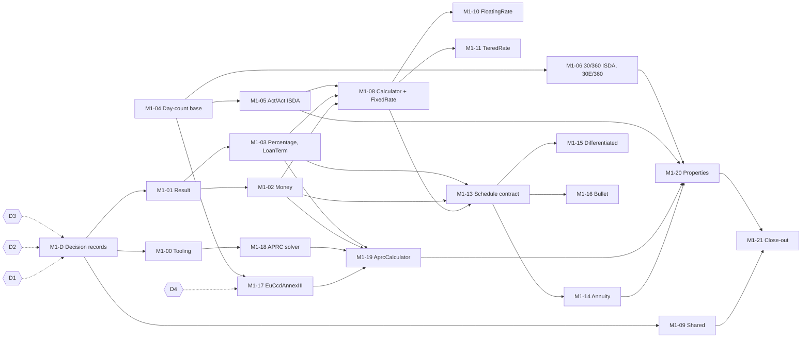

# M1 plan — Core math and shared primitives

**Status:** Approved (2026-11-19).

This plan splits the [M1 acceptance criteria](../roadmap.md#m1--core-math--shared-primitives) into tasks that two or three agents can run in parallel under [`parallel-development.md`](../parallel-development.md). Each task lists its dependencies, the owner decisions that gate it, the paths it owns, and whether it is a financial task that writes reference vectors first.

Approving this plan approves the new test files each task lists and the package and tool changes in M1-00. Those are the items AGENTS.md §13 names. Every PR still gets the owner's review.

## Decisions needed before work starts

These decisions came out of checking the M1 docs against each other and against the architecture tests. D1–D3 are new; D4 and D5 are existing open questions.

| # | Decision | Why it blocks | Recommendation | Gates |
|---|---|---|---|---|
| D1 | **Where `Result<T, E>` and `DomainError` live.** Core value objects must return `Result<T, DomainError>` (AGENTS.md §6, value-objects.md). But architecture.md §2, the roadmap and the AGENTS.md §3 code map put `Result` in `Credere.Shared`, and the architecture test `Core_depends_only_on_BCL_and_NodaTime` forbids Core from referencing Shared. As written, M1 can't compile. | Every Core type with a `Create(...)` | Move `Result`, `Unit` and the `DomainError` hierarchy into `Credere.Core`. They are BCL-only code, so no dependency rule or test changes. Record this in ADR-0009, which also changes `InvalidStateTransition(object FromState, …)` from ADR-0006 to `string`, because AGENTS.md §5 forbids `object` in public APIs. ADR-0006 stays unchanged, since ADRs are append-only. Alternative: let Core reference Shared, which needs an architecture-test change, an AGENTS.md §3 change and an ADR. | M1-D, then M1-01 and most tasks after it |
| D2 | **What `Credere.Shared` holds in M1.** Shared is BCL-only, but ADR-0005's outbox row has an `OccurredAt` `Instant` (NodaTime). | M1-09 | Shared holds time-free abstractions only: an integration-event marker with `Guid EventId`, `[Version(n)]`, `IIntegrationEventHandler<T>`, and a command marker with `Guid CommandId`. The outbox and receipt *rows* are module infrastructure, built in M2 with `IClock`. Where they live is decided with [open question #8](../open-questions.md). | M1-D, then M1-09 |
| D3 | **Coverage tool.** AGENTS.md §8 sets line-coverage targets (≥90% Core and Shared), but nothing in the stack measures coverage. | M1-00, M1-21 | `coverlet.collector` (`dotnet test --collect:"XPlat Code Coverage"`), with an ADR, as AGENTS.md §4 requires for a new dependency. | M1-D, then M1-00 and M1-21 |
| D4 | [Open question #9](../open-questions.md): APRC month-end counting | The month-end vectors of `EuCcdAnnexIII` | As in the open question: look for guidance, else an end-of-month rule. | M1-17 |
| D5 | [Open question #10](../open-questions.md): fractional powers outside the APRC solver | `EffectiveRate` | Leave `EffectiveRate` out of M1, and take it out of the roadmap's M1 acceptance. | M1-12 |

## Tasks

**Size:** S is about one focused session, M is two or three, L is more. **Vectors first** means the task commits its reference cases and the owner approves them before any implementation is written ([parallel-development.md](../parallel-development.md#task-lifecycle)).

All source paths are relative to `src/Credere.Core/` and all test paths to `tests/Credere.Core.Tests/`, unless they start with `src/`, `tests/` or `docs/`. Doc sections are named after the heading they own.

| Id | Task | Depends on | Gate | Owned paths | Size | Vectors first |
|---|---|---|---|---|---|---|
| M1-D | **Decision records** (coordinator, owner-approved docs). ADR-0009 (D1: placement of `Result` and `DomainError`, plus `InvalidStateTransition` with `string`). ADR-0010 (D3: coverage tool). The D1 lines in `docs/architecture.md`, `docs/roadmap.md` and the AGENTS.md §3 code map. The D2 note on open question #8. If D5 is decided as recommended, also the roadmap and open-questions changes for it. | — | D1–D3 (D5 if decided) | `docs/adr/0009-*.md`, `docs/adr/0010-*.md`, `docs/adr/README.md`, `docs/architecture.md`, `docs/roadmap.md`, `docs/open-questions.md`, `AGENTS.md` | S | — |
| M1-00 | **Tooling.** Stryker.NET as a local tool. The D3 coverage collector. `Verify.Xunit` in Core.Tests. `InternalsVisibleTo` from Core to Core.Tests. Remove the CS1591 suppression for `src/`, so public APIs need XML docs from now on. | M1-D | — | `Directory.Build.props`, `Directory.Packages.props`, `.config/dotnet-tools.json`, `tests/Credere.Core.Tests/stryker-config.json`, `src/Credere.Core/Credere.Core.csproj`, `tests/Credere.Core.Tests/Credere.Core.Tests.csproj`, `tests/Credere.Shared.Tests/Credere.Shared.Tests.csproj` | S | — |
| M1-01 | **`Result<T, E>`, `Unit`, `DomainError` hierarchy** (ADR-0006, placed per D1). Map/Bind laws as FsCheck properties. | M1-D | — | `Results/**`, tests `Results/**` | S | — |
| M1-02 | **`Money`.** `Create`, `Zero`, operators, rounding with `ToEven` when created, and the FsCheck algebra (associativity, identity, commutativity, cancellation). | M1-01 | — | `ValueObjects/Money.cs`, tests `ValueObjects/Money*.cs`, value-objects.md "`Money`" | M | — |
| M1-03 | **`Percentage` and `LoanTerm`.** | M1-01 | — | `ValueObjects/{Percentage,LoanTerm}.cs`, their tests, value-objects.md "`Percentage`" and "`LoanTerm`" | S | — |
| M1-04 | **`DayCountConvention` base, `Act360`, `Act365Fixed`.** Also an abstract FsCheck property base class that each convention's test class derives from, so later tasks never edit a shared test file. | — | — | `DayCounts/{DayCountConvention,Act360,Act365Fixed}.cs`, tests `DayCounts/{DayCountConventionPropertiesBase,Act360Tests,Act365FixedTests}.cs`, day-counts.md "Public contract", §2, §3 | M | Yes: ≥20 each, formula-derived from ISDA §4.16(e) and (d) |
| M1-05 | **Actual/Actual (ISDA).** | M1-04 | — | `DayCounts/ActActIsda.cs`, its tests, day-counts.md §1 | M | Yes: the 4 memo examples plus formula-derived cases |
| M1-06 | **30/360 ISDA and 30E/360.** The two 30-day-month conventions, in one task because they share the numerator shape, the doc and one vector review. The 30/360 ISDA tests also assert the non-additivity counterexample. | M1-04 | — | `DayCounts/{Thirty360Isda,ThirtyE360}.cs`, their tests, day-counts.md §4 and §5 | M | Yes: ISDA §4.16(f) and §4.16(g), every clause of each |
| M1-07 | *Merged into M1-06 (2026-11-19).* | — | — | — | — | — |
| M1-08 | **`IInterestCalculator`, `InterestCalculator`, `InterestRate` base, `FixedRate`.** | M1-02, M1-03, M1-05 | — | `Rates/{IInterestCalculator,InterestCalculator,InterestRate,FixedRate}.cs`, their tests, rates.md "`IInterestCalculator`", "`InterestRate`", "`FixedRate`" | M | Yes: the 4 ISDA memo examples as `FixedRate` cases plus formula-derived ones (≥5) |
| M1-09 | **Shared abstractions** (D2). Integration-event marker, `[Version(n)]`, `IIntegrationEventHandler<T>`, command marker with `CommandId`. | M1-D | — | `src/Credere.Shared/{IntegrationEvents,Commands}/**`, `tests/Credere.Shared.Tests/**` | S | — |
| M1-10 | **`FloatingRate`** with the `ResetSchedule.Fixed` placeholder. | M1-08 | — | `Rates/{FloatingRate,ResetSchedule}.cs`, their tests, rates.md "`FloatingRate`" | S | Yes (≥5) |
| M1-11 | **`TieredRate`** (both modes, nullable top limit). | M1-08 | — | `Rates/{TieredRate,TieredApplicationMode}.cs`, their tests, rates.md "`TieredRate`" | M | Yes (≥5 per mode) |
| M1-12 | *`EffectiveRate`: deferred out of M1 (D5, decided 2026-11-19).* | — | — | — | — | — |
| M1-13 | **Schedule contract.** `IScheduleGenerator`, `ScheduleRequest`, `PaymentFrequency`, `ScheduleRow`, and `AmortizationSchedule` with its invariants. It holds a collection, so it implements equality itself (AGENTS.md §6). Also the payment-date and period logic shared by all generators. | M1-02, M1-03, M1-08 | — | `Schedules/{IScheduleGenerator,ScheduleRequest,PaymentFrequency,ScheduleRow,AmortizationSchedule,SchedulePeriods}.cs`, their tests, schedules.md "Public contract", "Periods and interest" | M | Yes: payment-date cases, month-end included |
| M1-14 | **Annuity generator.** | M1-13 | — | `Schedules/AnnuityScheduleGenerator.cs`, its tests and Verify snapshots, schedules.md §1 | M | Yes: ≥10 full schedules; snapshots need owner review |
| M1-15 | **Differentiated generator.** | M1-13 | — | `Schedules/DifferentiatedScheduleGenerator.cs`, its tests and snapshots, schedules.md §2 | M | Yes |
| M1-16 | **Bullet generator** (both modes). | M1-13 | — | `Schedules/BulletScheduleGenerator.cs`, its tests and snapshots, schedules.md §3 | M | Yes |
| M1-17 | **`EuCcdAnnexIII`**, the APRC time basis. | M1-04 | D4 | `Aprc/EuCcdAnnexIII.cs`, its tests, aprc.md "Time intervals" | M | Yes: the 6 cases in aprc.md plus ≥14 formula-derived |
| M1-18 | **APRC solver** (internal bisection). | M1-00 | — | `Aprc/AprcSolver.cs`, its tests | M | Yes: the 8 Directive 98/7/EC examples |
| M1-19 | **`AprcCalculator`** (public). Validation errors, rounding to `Disclosed`, end-to-end B1–B4. | M1-02, M1-03, M1-17, M1-18 | — | `Aprc/{IAprcCalculator,AprcCalculator,AprcRequest,AprcResult,CashFlow}.cs`, their tests, aprc.md "Rounding", "Implementation" | M | Uses the M1-18 vectors |
| M1-20 | **Cross-cutting properties.** APRC round-trip (aprc.md), and per-period interest summing to the whole-period interest for the additive conventions (AGENTS.md §8). | M1-05, M1-06, M1-14, M1-19 | — | tests `Properties/**` | S | — |
| M1-21 | **Close-out** (coordinator). Stryker (≥80% Core; 85% on the APRC files), coverage (≥90% Core and Shared), architecture tests, `docs/status.md`, the roadmap acceptance check, and asking the owner for the `m1` tag. Surviving mutants and coverage gaps become new tasks for the owners of those files. | all | — | `docs/status.md`, `docs/roadmap.md` (M1 section) | S | — |

D5 was decided as recommended: M1-12 moved to a later milestone, and the roadmap changed with it (M1-D). M1-07 was merged into M1-06 to save one handoff and one vector review.

## Dependency graph

**Critical path:** D1 → M1-D → M1-01 → M1-02 → M1-08 → M1-13 → M1-14 → M1-20 → M1-21. M1-08 also waits for M1-04 → M1-05. Three vector reviews sit on this path (M1-05, M1-08, M1-14), so the owner reviewing those first shortens the milestone most.

**Ready at the start:** M1-04 needs no decision and starts at once. M1-D starts once D1–D3 are decided. When M1-D merges, M1-00, M1-01 and M1-09 can run alongside M1-04. None of them touches another's files: M1-01, M1-04 and M1-09 only add source and test files, and M1-00 owns the project files.

## Lanes

Each implementer works through one lane continuously ([parallel-development.md](../parallel-development.md#working-continuously)), and takes a `ready` task from the other lane when its own has none. The lanes are split by vendor so every task is reviewed by the other one.

| Lane | Agent | Sequence | Focus |
|---|---|---|---|
| A | Claude Code | M1-01 → M1-02 → M1-03 → M1-08 → M1-13 → M1-14 → M1-20, and M1-09 | The critical path: kernel types, interest, schedules; Shared |
| B | Codex | M1-05 → M1-06 → M1-00 → M1-18 → M1-10 → M1-11 → M1-15 → M1-16, then M1-17 and M1-19 | Day counts, tooling, rates, APRC |

The coordinator ran M1-D first and runs M1-21 last. Every vector set is recomputed independently by an agent from the other vendor before the owner reviews it, as was done for the corrected domain docs.

## Acceptance mapping

| Roadmap M1 criterion | Tasks |
|---|---|
| `Money`, `Percentage`, `LoanTerm`, `InterestRate` (fixed, floating, tiered, effective), five `DayCountConvention`s | M1-02, M1-03, M1-08, M1-10, M1-11, M1-04 to M1-06; `EffectiveRate` deferred (D5) |
| `IInterestCalculator` as the single entry point for interest | M1-08 |
| Annuity, differentiated, bullet generators | M1-13 to M1-16 |
| `AprcCalculator` per 2023/2225 Annex III, reproducing the 98/7/EC examples | M1-17 to M1-19 |
| `Result<T, E>`, outbox contracts, idempotency primitives | M1-D, M1-01 (per D1), M1-09 (per D2) |
| Core ≥90% line and ≥80% mutation coverage | M1-00, M1-21 |
| Reference sources cited in XML docs and tests | Every task marked "Vectors first" |
| All property-based invariants pass | M1-02, M1-04 to M1-08, M1-20, M1-21 |
