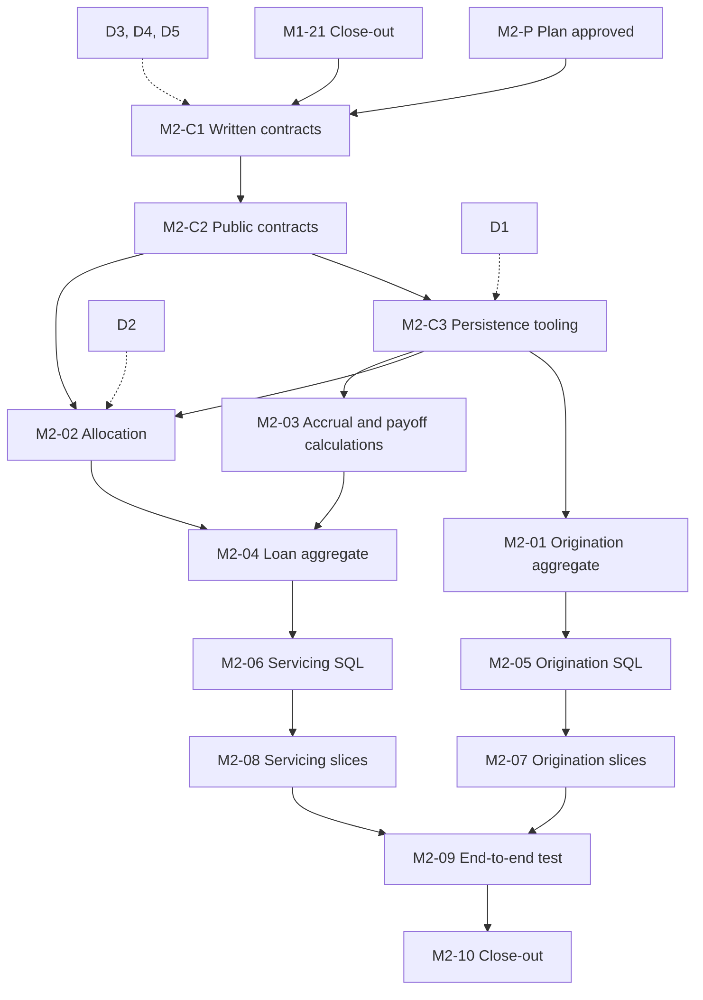

# M2 plan — Origination and Servicing

**Status:** Approved (2026-11-25). The owner records decisions D1–D5 on the issues they gate.

After [M1 closes](m1.md), deliver the Origination and Servicing facades, loan lifecycle, payment allocation, and SQL Server persistence. The owner approves this plan and creates the issues. The coordinator records owner decisions before clearing gates. The close-out uses the [M2 roadmap acceptance](../roadmap.md#m2--origination--servicing-modules).

## Owner decisions

| ID | Question | Recommendation | Gates | Owner decision |
|---|---|---|---|---|
| D1 | Where do SQL Server converters, outbox rows and receipt rows live? [Open question #8](../open-questions.md#8-where-do-shared-persistence-converters-live). | Keep them in each module's `Infrastructure/` for M2. This preserves the current project boundaries and leaves each schema independently migratable. Revisit a shared persistence project with its own ADR if the duplication warrants it. If the owner chooses that project now, revise the task paths and dependency rules before implementation. | M2-C3 | Pending |
| D2 | What source supports the five payment-allocation reference cases? The cited ECB annex with worked cases has yet to be located. | Ask for a published or owner-supplied contractual example with the same priority order. If no such example is available, ask the owner to approve the waterfall in [payment-allocation.md](../domain/payment-allocation.md#formal-rules) as Credere's product rule and approve documented, independently computed vectors derived from it. Article 21(1)(h) concerns disclosure of allocation order where applicable. [Directive (EU) 2023/2225](https://eur-lex.europa.eu/eli/dir/2023/2225/oj/eng) | M2-02 | Pending |
| D3 | What are the approved payment and lifecycle transitions? The diagram, transition table, and waterfall text disagree on overpayments and eligible states. The roadmap says every transition emits an event, while aging on an active loan with zero days past due is an explicit no-op. | Retain the table's Active, InGrace, and PastDue payment eligibility pending a decision on Defaulted loans. Permit positive overpayments on eligible loans, allocate through the waterfall, and record the excess for return. Specify the behavior and event payload for excess, the cure and re-aging rows, and the difference between a no-op and a state transition. Approve the table and diagram together before changing Loan. | M2-C1 | Pending |
| D4 | How does borrower acceptance reach Servicing without a module-to-module reference? The catalog names `ApplicationDecided` as the handoff. The Servicing spec consumes `ApplicationAccepted` and names an Origination ID in its aggregate. | Use `ApplicationAccepted` after borrower acceptance. Have the composition boundary translate that publisher-owned event into a Servicing-owned input with an opaque source ID and the accepted terms version. Persist an idempotent intent before confirming disbursement. Approve the input contract and the mapping in the end-to-end test. Run the M2 test against the real outbox payload and subscriber receipt. Production polling, retries, and dispatch stay scheduled for [M4](../roadmap.md#m4--reporting-module--batch--outbox). | M2-C1 | Pending |
| D5 | Which business-date, accrual, and payoff rules does the M2 product support? The module sketch leaves business calendars, accrual posting and rounding, and quote validity underspecified. | Specify the supported rate and schedule types, business-date and holiday-calendar inputs, posting and rounding boundaries, and quote validity and revalidation. Use M1's `IInterestCalculator` and an approved product day count for the calculation. The host supplies explicit dates and configures calendar inputs. Require cited references and approved vectors before any new financial calculation. | M2-C1 | Pending |

## Tasks

Each row gives the issue title prefix, **Depends on**, and **Gate**. The owner copies the fields into the [task brief](../parallel-development.md#task-brief-template) using the following form. Dependency IDs are comma-separated. A gate of `—` allows the workflow to move the issue to `ready` after its dependencies close. For multiple decisions, clear the gate after the last decision is recorded.

```text
Milestone plan: docs/plans/m2.md · Depends on: M2-C2, M2-C3 · Gate: D2 · Size: S
```

The `O/` and `S/` path prefixes below expand to `src/Credere.Modules.Origination/` and `src/Credere.Modules.Servicing/`. The `OT/` and `ST/` prefixes expand to their corresponding projects under `tests/`, `tests/Credere.Modules.Origination.Tests/` and `tests/Credere.Modules.Servicing.Tests/`. Use expanded paths in issue briefs and `.task-paths`. Size follows [M1](m1.md#tasks). A vectors-first task opens a draft with cited vectors, obtains an independent recomputation from the other vendor, and waits for the owner's approval before writing implementation.

### Contract tasks

| ID | Goal | Depends on | Gate | Owned paths | Size | Vectors first |
|---|---|---|---|---|---|---|
| M2-C1 | **Approve the written contracts.** Reconcile the architecture event catalog with the two module docs. Record the approved handoff and capture all publisher events and intended subscribers, including terminal events and the owner's decision on payment excess. Write the exact facade signatures and DTOs for commands, queries, IDs, views and event payloads. Use `cancellationToken` in interface sketches. Resolve the lifecycle, calendar, accrual and payoff rules before domain work. Record the decisions in the owned docs and add an ADR if the owner approves a new boundary decision. | M1-21, M2-P | D3, D4, D5 | `docs/architecture.md` (§6, §8), `docs/modules/{origination,servicing}.md` (contract sections), `docs/domain/loan-lifecycle.md`, `docs/adr/*-m2-module-contracts.md`, `docs/adr/README.md` | M | — |
| M2-C2 | **Land public contracts for both modules.** Define the facade interfaces and the documented commands, queries, IDs, views, module errors, and versioned publisher event records. Put command and query contracts in their feature folders, and use the M1 Shared markers. Split each existing interface out of its composition file so later tasks can register facades independently. Verify the contract and dependency boundaries. | M2-C1 | — | `O/OriginationModule.cs`, `S/ServicingModule.cs`, `O/IOriginationModule.cs`, `S/IServicingModule.cs`, `O/Contracts/**`, `S/Contracts/**`, `O/Application/{Commands,Queries}/**`, `S/Application/{Commands,Queries}/**`, `O/IntegrationEvents/**`, `S/IntegrationEvents/**`, `OT/Contracts/**`, `ST/Contracts/**` | M | — |
| M2-C3 | **Prepare persistence tooling.** Record D1, configure the pinned local EF migration tool, its design-time references and test project references, and grant internal visibility only to each module's own test project. Use the pinned SQL Server, Testcontainers and coverage packages. Seek separate approval for any new NuGet dependency. The per-module persistence tasks own the contexts, mappings, generated migrations, and test fixtures. | M2-C2 | D1 | `docs/open-questions.md` (§8), `.config/dotnet-tools.json`, `O/Credere.Modules.Origination.csproj`, `S/Credere.Modules.Servicing.csproj`, `OT/Credere.Modules.Origination.Tests.csproj`, `ST/Credere.Modules.Servicing.Tests.csproj`, `tests/Credere.Integration.Tests/Credere.Integration.Tests.csproj`, `src/Credere.Api/Credere.Api.csproj` | S | — |

### Implementation tasks

| ID | Goal | Depends on | Gate | Owned paths | Size | Vectors first |
|---|---|---|---|---|---|---|
| M2-01 | **Origination aggregate.** Implement submission, underwriting decisions, acceptance of versioned terms, withdrawal, domain events, and history replay. Test valid and invalid transitions. | M2-C3 | — | `O/Domain/**`, `OT/Domain/**` | M | — |
| M2-02 | **Payment allocation.** Correct the reference section and reconcile the waterfall doc with the approved lifecycle rules. Record at least five cases from the D2 source with their exact inputs and outputs. Implement the allocation priority, conservation, excess, and balance invariants with example and property tests. The allocation result type comes from M2-C2. | M2-C2, M2-C3 | D2 | `S/Domain/PaymentAllocationWaterfall.cs`, `ST/Domain/PaymentAllocation/**`, `docs/domain/payment-allocation.md` | M | Yes |
| M2-03 | **Accrual and payoff calculations.** Implement pure, explicit-date calculations using the M1 calculator and the D5 contract. Cover interest boundaries, quote amounts and rounding with cited cases. Test the calculation separately from SQL ledger and command checks. | M2-C3 | — | `S/Domain/InterestAccrual.cs`, `S/Domain/PayoffCalculation.cs`, `ST/Domain/InterestAccrual/**`, `ST/Domain/PayoffCalculation/**` | M | Yes, ≥5 reference cases per new calculation |
| M2-04 | **Loan aggregate.** Implement approved lifecycle transitions and domain events, replay, activation, aging and terminal outcomes. Apply waterfall results from the first payment slice and route payoff through the approved quote and calculation contract. Test every aggregate operation and transition, including aging no-ops, partial and closing payments, invalid states, and replay. | M2-02, M2-03 | — | `S/Domain/Loan*.cs`, `S/Domain/Events/**`, `ST/Domain/Loan/**` | L | —, uses the approved M2-02 and M2-03 vectors |
| M2-05 | **Origination SQL persistence.** Add `OriginationDbContext`, the `origination` schema, a design-time factory, generated migrations, explicit converter mappings, current state with RowVersion, history, outbox and per-handler receipt tables. Provide internal persistence operations for the facade. Verify mapping, concurrency and transactional rollback against SQL Server Testcontainers. | M2-01 | — | `O/Infrastructure/**`, `OT/Infrastructure/**` | M | — |
| M2-06 | **Servicing SQL persistence.** Add `ServicingDbContext`, the `servicing` schema, a design-time factory and generated migrations. Map current state with RowVersion, history, outbox, command and subscriber receipts, disbursement intents, schedule snapshots and accrual ledger. Enforce receipt, stream version and business-date uniqueness. Verify mapping, rollback and concurrency with SQL Server Testcontainers. | M2-04 | — | `S/Infrastructure/**`, `ST/Infrastructure/**` | L | — |
| M2-07 | **Origination facade and slices.** Wire submit, decide, accept, withdraw, get and list through the real persistence operations and module DI. Store command outcome, state, history and outbox events atomically. Test retried and concurrent duplicate commands for stable results and a single emission. | M2-05 | — | `O/OriginationModule.cs`, `O/Application/**`, `OT/Application/**` | M | — |
| M2-08 | **Servicing facade and slices.** Wire the approved handoff, disbursement, activation, allocation, aging, payoff, terminal commands, query projections and schedule retrieval. Use the intent and accepted terms version for disbursement. Persist servicing state, history, outbox, receipts and ledger entries through one transaction per applicable command. Test duplicate delivery, concurrent retry, duplicate accrual for a business date and single emission. | M2-06 | — | `S/ServicingModule.cs`, `S/Application/**`, `ST/Application/**` | L | — |

### Integration and close-out

| ID | Goal | Depends on | Gate | Owned paths | Size | Vectors first |
|---|---|---|---|---|---|---|
| M2-09 | **End-to-end SQL Server test.** Compose the real module registrations and apply both migrations. Submit, approve, accept terms, deliver the persisted `ApplicationAccepted` event through the approved boundary, disburse, activate, record multiple payments, apply aging and execute payoff. Assert resulting balances, lifecycle, transactional history, outbox and receipts. Replay the event and retry commands to verify they produce no duplicate intent, loan, payment or events. | M2-07, M2-08 | — | `tests/Credere.Integration.Tests/M2/**` | M | — |
| M2-10 | **M2 close-out (coordinator).** Check every roadmap criterion against merged code and SQL Server tests. Run the full build, suite, formatting and architecture checks. Verify ≥85% line coverage for each module's Application and Domain code and rerun the M1 Core mutation floor if Core changed during the milestone. Record implemented, verified and reviewed work in the status doc, and ask the owner for the `m2` tag. | all | — | `docs/status.md`, `docs/roadmap.md` (M2 only) | S | — |

M2-C2 owns edits to the composition files and command and query feature folders until it merges. M2-07 and M2-08 then own these paths in their respective modules. The migrations remain with their module's persistence task. If a slice needs a schema change after its persistence task merges, raise it with the coordinator for a separately scoped task. Schedule Docker-backed suites one at a time as described in [Parallel development](../parallel-development.md#checks).

### Next milestone plan

| ID | Goal | Depends on | Gate | Owned paths | Size | Vectors first |
|---|---|---|---|---|---|---|
| M3-P | **Write the M3 plan.** Draft `docs/plans/m3.md` from the roadmap's M3 acceptance and the outline in docs/plans/README.md, against the M2 contracts as merged. Status Proposed; the owner approves it and creates the M3 issues. Include an M4-P task that writes the next plan. | M2-C2 | — | `docs/plans/m3.md`, `docs/plans/README.md` | M | — |

M3-P carries the `m3` label, so the M2 close-out doesn't wait for it.

## Dependency graph



**Critical path.** M2-C1 → M2-C2 → M2-C3 → M2-02 and M2-03 → M2-04 → M2-06 → M2-08 → M2-09 → M2-10. Allocation and accrual/payoff can proceed in parallel after tooling. The Loan aggregate starts after both of those tasks merge, and each needs vector approval before implementation. Origination can proceed while both sets of vectors are under review.

## Lanes

| Lane | Implementer | Sequence |
|---|---|---|
| A | Claude Code | M2-C1 → M2-C3 → M2-01 → M2-05 → M2-07 → M2-04 → M2-09 |
| B | Codex | M2-C2 → M2-02 → M2-03 → M2-06 → M2-08 |

The lanes use the [continuous work loop](../parallel-development.md#working-continuously). The implementer who did not author a task reviews its code and independently recomputes the vectors where required. The owner approves contract changes and vectors and merges each PR. The coordinator runs M2-10 after the other M2 issues close.

## Acceptance mapping

| M2 roadmap criterion | Tasks |
|---|---|
| Both public facades, commands, queries and integration events | M2-C1, M2-C2, M2-01, M2-07, M2-08 |
| Complete loan state machine with domain events | M2-C1, M2-04, M2-08, M2-09 |
| Payment allocation with at least five reference cases | M2-02, M2-04, M2-08 |
| Per-module SQL Server contexts, schemas, migrations and RowVersion | M2-C3, M2-05, M2-06 |
| Append-only history recorded transactionally | M2-05, M2-06, M2-07, M2-08, M2-09 |
| Per-handler receipts and proof duplicate commands emit once | M2-05, M2-06, M2-07, M2-08, M2-09 |
| SQL Server end-to-end path from application submission through payoff | M2-03, M2-09 |
| Architecture tests pass and modules stay isolated | M2-C2, M2-09, M2-10 |
